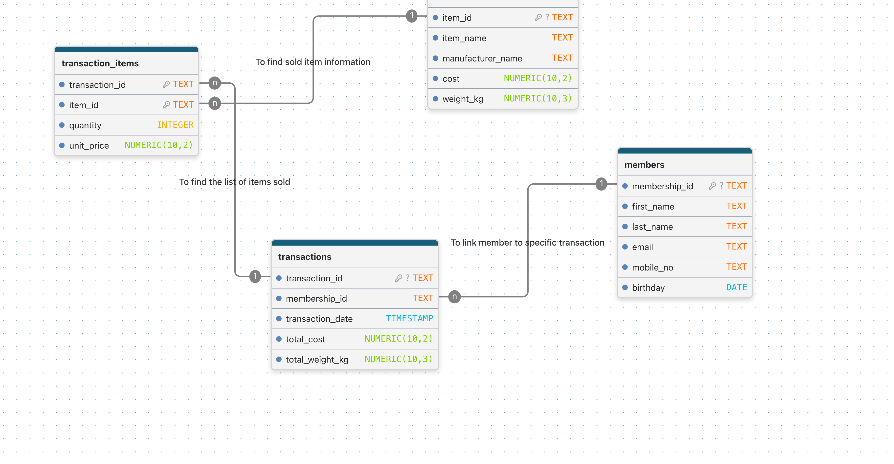
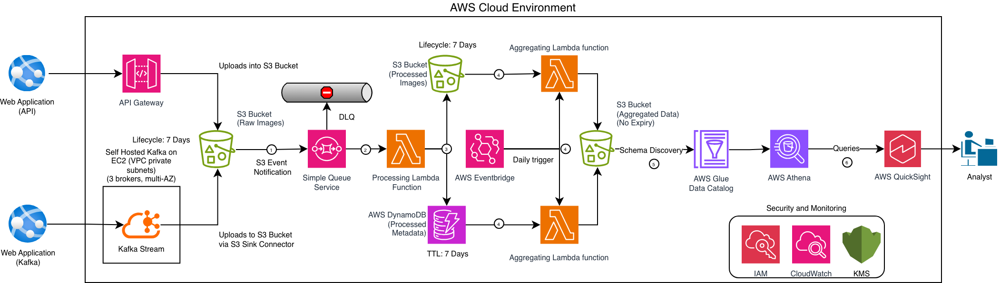

# Data Engineering Projects: Databases & Cloud Architecture

Two data engineering projects: a relational database you can start with Docker, and a cloud architecture for an image-processing platform.

| Project | What it shows | Stack |
|---|---|---|
| [**Sales Transactions Database**](sales-database/) | Normalised schema design, data integrity constraints, indexing for analyst queries, reproducible setup with Docker | PostgreSQL, Docker Compose, SQL, Python |
| [**Image Processing Platform**](image-platform-architecture/) | End-to-end AWS design: streaming and API ingestion, event-driven processing, 7-day privacy retention, serverless BI | AWS (S3, SQS, Lambda, DynamoDB, Kafka on EC2, Glue, Athena, QuickSight) |

> **About this repo:** this started as a data engineering take-home assessment. Afterwards I reworked it into a portfolio project, using Claude to help restructure the repo, replace the original dataset with synthetic data, and organise the commits. The schema design, SQL queries, AWS architecture and design write-up are my original assessment work.

## Sales Transactions Database
[](sales-database/)

A PostgreSQL schema for members, items and multi-item transactions. It records the price at time of purchase, uses `NUMERIC` for money, and enforces `CHECK` and foreign key constraints. One command starts it with sample data:

```bash
cd sales-database && docker compose up --build -d
```

Includes analyst queries for the top spenders and best-selling items. [Read more →](sales-database/)

## Image Processing Platform (AWS)
[](image-platform-architecture/)

Images arrive through API Gateway and a self-managed Kafka cluster, are buffered by SQS, processed by Lambda, and purged after 7 days using S3 lifecycle rules and DynamoDB TTL. Non-identifying daily aggregates are kept permanently for analysts in Athena and QuickSight. [Read the full design and trade-offs →](image-platform-architecture/)
