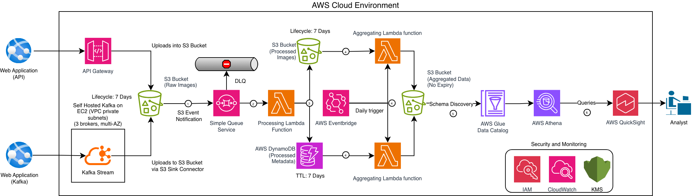

# Image Processing Platform: AWS Architecture

An AWS architecture that ingests images from two sources, runs existing processing code on them, purges images and metadata after 7 days for privacy compliance, and gives analysts a Business Intelligence layer.

## Problem
- Images arrive from **two sources**: a web app that uploads through an API, and a separate web app that publishes to a **Kafka stream the company's own engineers operate**.
- Existing **image-processing code** must run in the cloud.
- Images and their metadata must be **kept for 7 days and then purged** (compliance and privacy).
- Analysts need a **BI environment** to explore and compute over the data.

## System Overview

Step numbers in the sections below refer to the numbered labels in the diagram.

### Ingestion
Images enter the platform from two sources: a web application API and a Kafka stream.

- **Web application API:** images are uploaded through Amazon API Gateway, which stores them in the raw images S3 bucket.
- **Kafka stream:** the web application publishes image messages to a Kafka topic hosted on self-managed brokers running on Amazon EC2 instances in private VPC subnets. An S3 Sink Connector then writes the images to the raw images S3 bucket.

### Processing
1. When an image reaches the raw images S3 bucket, Amazon S3 sends an event notification to an Amazon SQS queue **(step 1)**.
2. AWS Lambda polls the queue and runs the processing code on each image **(step 2)**.
3. The processed image is stored in the processed images S3 bucket, and its metadata in Amazon DynamoDB **(step 3)**.

Messages that fail processing after N attempts are moved to a dead-letter queue, and a CloudWatch alarm on the queue notifies engineers so they can investigate.

### Aggregation
Amazon EventBridge triggers the aggregation Lambda functions once a day **(step 4)**. They derive non-identifying statistics from the processed images and metadata and write them to the aggregated data S3 bucket, which has no expiry so that analysts can build up a long-term history.

### Query and Business Intelligence
1. An AWS Glue crawler scans the aggregated data S3 bucket and records its schema in the Glue Data Catalog **(step 5)**.
2. Amazon Athena queries the aggregated data in S3, using the Glue Data Catalog for table definitions. Amazon QuickSight uses Athena as its data source to provide dashboards for analysts **(step 6)**.

### Data Retention
Images and their metadata are purged after 7 days to comply with the privacy requirement.

| Store | Contents | Retention mechanism |
|---|---|---|
| Raw images S3 bucket | Uploaded images | S3 Lifecycle rule: expire after 7 days |
| Processed images S3 bucket | Processed images | S3 Lifecycle rule: expire after 7 days |
| Amazon DynamoDB | Image metadata | TTL: expire after 7 days |
| Aggregated data S3 bucket | Non-identifying statistics | No expiry |

### Security and Monitoring
These services apply across all components of the platform:

- **AWS IAM:** ensures only authorised users and services can access each resource.
- **Amazon CloudWatch:** collects logs and metrics, and notifies engineers through alarms when an issue requires attention.
- **AWS KMS:** encrypts data at rest to keep it secure.

## Assumptions and Justifications
This section covers the assumptions made when designing the system, as well as the justifications for the services used.

### General Assumptions
- Images sent are below the 10 MB request limit for API Gateway.
- Images fit within the configured Kafka broker message size limit.
- The data processing task is not computationally heavy and takes only a short time.
- The existing processing code is able to run on Lambda.
- Both image sources use the same processing code.
- A daily DynamoDB scan is acceptable at the current volume.
- Non-identifying aggregated statistics are not covered by the 7-day retention policy.

### Justifications
- **API Gateway:** a managed entry point with authentication and throttling. It can also write directly to S3 buckets.
- **Self-Hosted EC2:** as the Kafka stream is managed by the company's engineers, self-managing gives them full control over broker configuration, versions and tuning.
- **Resilience:** the Kafka cluster runs three brokers, each on its own EC2 instance in a separate Availability Zone, so the stream remains available if one broker fails.
- **SQS between S3 and Lambda:** absorbs bursts of uploads, retries failures, and enables the DLQ to preserve failed attempts.
- **S3 for images:** durable, cheap, and has built-in lifecycle rules to comply with the privacy requirement.
- **Processing Service Choice:** since the processing load is assumed to be low, Lambda is chosen over alternatives such as Fargate. If the processing load is higher and exceeds Lambda's 15-minute limit, Fargate should be used instead.
- **Metadata Storage Choice:** DynamoDB is used to store metadata as it is only used for storage, and a relational database is not needed since no joins are required. The images are stored in S3. DynamoDB TTL and S3 lifecycle rules remove each item within 7 days, following privacy compliance.
- **Separation of Processing and Aggregation:** processing and aggregation are separated for two reasons. First, each Lambda handles only one task, which makes it easier to monitor and debug. Secondly, it ensures that an aggregation failure does not block image processing, and vice versa.
- **Daily EventBridge Schedule:** aggregation runs well within the 7-day window, so no data expires before it is aggregated.
- **Business Intelligence vs Privacy:** permanent, non-identifying aggregated data is used instead of being limited to 7 days of data, because 7 days of data may not be robust enough to give meaningful or accurate insights.
- **Glue + Athena + QuickSight instead of Redshift:** these services are serverless and pay-per-query, which suits a modest volume of data.