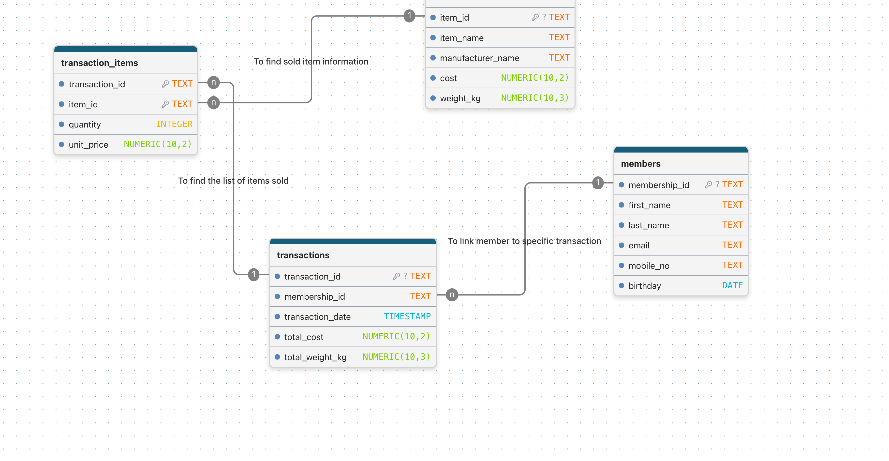

# Sales Transactions Database

A PostgreSQL database for an e-commerce store's sales transactions. One Docker command starts it, and it creates the schema and loads sample data on first start-up.

**Scenario:** members buy items on the website, and each purchase can contain one or more items. Each item has a name, manufacturer, cost and weight. Each transaction records the member, the items bought, the total price and the total weight. Analysts need to answer questions such as *"who are our top spenders?"* and *"which items sell best?"*, and the schema should support a wide range of other queries too.

**Stack:** PostgreSQL 18 · Docker / Docker Compose · SQL

## Quick start
```bash
cd sales-database
docker compose up --build -d                                              # build and start; schema + seed data load automatically
docker compose exec db psql -U postgres -d ecommerce                      # interactive SQL session
docker compose exec -T db psql -U postgres -d ecommerce < queries/query1.sql   # run a saved query
```

> Initialisation scripts only run against an empty database. After changing any SQL file, reset with `docker compose down -v` and start again.

## Schema


| Table | Purpose |
|---|---|
| `members` | One row per member, keyed on `membership_id` |
| `items` | Product catalogue: name, manufacturer, cost, weight |
| `transactions` | One row per purchase: member, timestamp, total cost and weight |
| `transaction_items` | One row per item per transaction (quantity and price paid) |

- A **member** makes many **transactions**, and each transaction belongs to one member.
- A **transaction** contains one or more **items**, and an item appears in many transactions. `transaction_items` resolves this many-to-many relationship.

## Design decisions
- **Link table instead of item lists:** storing items as one row per item per transaction (keyed on `(transaction_id, item_id)`) avoids putting lists in a single column or repeating transaction details for every item.
- **Price at time of purchase:** `unit_price` is stored on each line item, so past transactions stay correct if an item's catalogue price changes later.
- **Stored totals:** `total_cost` and `total_weight_kg` live on `transactions` for convenient queries. They can always be recalculated from the line items.
- **Exact numeric types:** money and weights use `NUMERIC` rather than `FLOAT` to avoid floating-point rounding errors.
- **Integrity at the database level:** `NOT NULL`, foreign key and `CHECK` constraints (for example `quantity > 0` and `cost > 0`) reject bad data when it is inserted.
- **Indexes for the queries analysts run:** foreign keys (`transactions.membership_id`, `transaction_items.item_id`) are indexed because the queries join on them, and PostgreSQL does not index foreign keys automatically. `transaction_date` is indexed for date-range reporting, such as monthly revenue.

## Analyst queries

### Top 10 members by spending: [`queries/query1.sql`](queries/query1.sql)
```
  membership_id  | total_spending
-----------------+----------------
 Xu_c6a1b        |        5096.10
 Hughes_95b32    |        2159.60
 Lim_683c6       |        2157.50
 Ellis_95ecc     |        1883.80
 Ibrahim_833a1   |        1610.20
 Underwood_ed9c9 |        1347.70
 Underwood_0bd88 |        1307.50
 Bennett_74748   |        1053.80
 Underwood_c421d |         981.10
 Underwood_064f4 |         735.20
```

### Top 3 most frequently bought items: [`queries/query2.sql`](queries/query2.sql)
"Frequently bought" means total quantity sold. Counting transactions instead gives the same top 3.
```
   item_name    | total_purchases
----------------+-----------------
 Phone Case     |              39
 Wireless Mouse |              28
 USB-C Hub      |              17
```

## Sample data
- **Members:** 50 synthetic members generated by [`scripts/generate_members.py`](scripts/generate_members.py), which uses only the standard library and a fixed seed. Membership IDs have the format `<last_name>_<first 5 hex characters of SHA-256(YYYYMMDD birthday)>`.
- **Items and transactions:** 15 items and 60 hand-written transactions in [`sql/02_seed_data.sql`](sql/02_seed_data.sql). Every transaction's totals equal the sum of its line items.

## Limitations and next steps
- **Natural key collisions:** `membership_id` is derived from a last name and birthday, so two people with the same surname and birthday would get the same ID. In production I would add a surrogate `member_id` primary key and keep `membership_id` as a unique business identifier.
- **Stored totals can drift** from their line items if one is updated without the other. A trigger or a view that derives the totals would enforce consistency.
- **No free items:** `CHECK (cost > 0)` assumes the store never lists free items.
